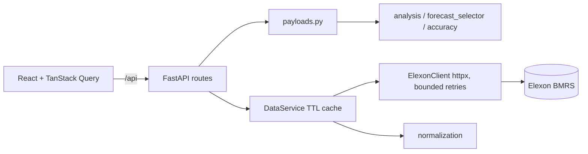

# WindWise — Wind Forecast Intelligence & Day-Ahead Procurement Decision Support

WindWise helps electricity procurement analysts see **which wind forecast was available when a day-ahead purchasing decision had to be made**, and **how accurate that forecast was** compared with actual national wind generation. It uses Elexon BMRS data and focuses on January 2026 purchasing decisions.

It is a decision-support tool. It does not calculate an optimal procurement position, because demand, contract and price inputs are outside the scope of this challenge.

## Live application
- **Frontend (Vercel):** https://windwise-kappa.vercel.app
- **Backend API (Render):** https://windwise-1mjb.onrender.com (health check: `/api/health`, API docs: `/docs`)

> The backend runs on Render's free tier. It sleeps after about 15 minutes without traffic, so the **first request can take around a minute** while it wakes up and loads data from Elexon. Later requests are faster because source data is cached in memory.


## Key capabilities
- **Dashboard:** latest eligible forecast for a selected delivery date, its publication time, average forecast and actual generation, MAE, RMSE, bias and data coverage.
- **Forecast vs actual chart:** UK local time, with gaps shown where data is missing (no invented values).
- **Forecast error analysis:** signed and absolute errors, over- and under-forecast counts, largest errors, and an error distribution summary.
- **Forecast publication history:** audit view of which revision was selected, earlier revisions, and later revisions that were not available at the cutoff.
- **Historical accuracy:** MAE, RMSE, bias, MAPE and daily summaries for January 2026.
- **Settlement-period table:** searchable, sortable, with CSV export.
- **Data-quality panel:** expected, retrieved and matched intervals, missing, invalid and duplicate records, and retrieval status.
- **Methodology page:** data sources, selection logic, formulas and limitations.

## Data sources and field mapping
Base URL: `https://data.elexon.co.uk/bmrs/api/v1` (no API key needed).

| Dataset | Endpoint | Fields used |
|---|---|---|
| FUELHH (actual generation) | `/datasets/FUELHH/stream?settlementDateFrom&settlementDateTo&fuelType=WIND` | `startTime` (target time, 30 min), `generation` (MW), `fuelType` (WIND only) |
| WINDFOR (forecasts) | `/datasets/WINDFOR/stream?publishDateTimeFrom&publishDateTimeTo` | `startTime` (delivery time), `publishTime` (when the forecast was created), `generation` (MW) |

`startTime` (delivery) and `publishTime` (forecast creation) are never used interchangeably.

## Forecast selection and look-ahead bias
Forecasts are revised over time, so one delivery interval can have several forecasts with different publish times. For each delivery interval, WindWise selects the forecast with the **latest `publishTime` at or before the decision cutoff**. Forecasts published later are never used, because the buyer could not have seen them when deciding. Using the newest available forecast would be look-ahead bias.

- Forecasts are fetched by **publish time**, starting `FORECAST_LOOKBACK_DAYS` (default 7) before the first cutoff. Forecasts published in December 2025 for early-January delivery are therefore included.
- The fetch window ends at the last cutoff. Only the `/api/revisions` audit view fetches later revisions, in order to label them `LATER_UNAVAILABLE`.
- Duplicate records: different publish times for the same delivery time are kept as revisions. Records with an identical delivery time and publish time collapse into one, and conflicting values are counted.

### Decision cutoff
The decision cutoff is configurable. The assignment specifies that day-ahead purchasing decisions are made one day before delivery but does not define an exact local cutoff time. The initial value of **09:20 Europe/London on the day before delivery is an assumption** and must be validated against the intended market workflow. It represents the time the purchasing decision is made, not a forecast publication time.

Settings: `DECISION_CUTOFF_LOCAL_TIME`, `DECISION_CUTOFF_DAYS_BEFORE`, `TIMEZONE` (only Europe/London is supported).

## Evaluation resolution
Forecast values are **never interpolated**. With `EVALUATION_RESOLUTION=auto`, the application inspects the WINDFOR start times:
- All on the hour: evaluation is **hourly**. The actual for each hour is the mean of the two half-hourly MW values. An hour with only one half-hour counts as a missing actual.
- `:30` start times present: evaluation is **half-hourly**.

Source records are kept unchanged, and matched-interval counts are reported at the evaluation resolution. Assumption to confirm against Elexon documentation: `startTime` marks the start of the interval in both datasets.

## Accuracy metrics
All metrics are calculated in the backend, in MW, using intervals that have both a selected forecast and a valid actual.

`error = forecast − actual` (positive = over-forecast, negative = under-forecast)

| Metric | Definition |
|---|---|
| MAE | mean of abs(error) |
| RMSE | sqrt(mean(error²)) |
| Bias | mean(error) |
| MAPE | mean(abs(error) / abs(actual)) × 100, only where actual ≠ 0 (excluded count is reported) |
| Median absolute error | median of abs(error) |

## Missing data, timezone and daylight saving
- Missing, negative, infinite or non-numeric generation values are rejected and counted. They are **never replaced with zero**.
- With no eligible data, metrics are `null` and shown as "—".
- All timestamps are timezone-aware. Internally they are UTC. Delivery days, the cutoff and display use **Europe/London**.
- Clock-change days have 46 or 50 half-hours (23 or 25 hours). A cutoff that falls inside a spring-forward gap raises an error instead of being moved silently.

## Architecture

The backend does all the analysis. The frontend only displays the results.

**Stack:** React, TypeScript, Vite, Tailwind CSS, Recharts, TanStack Query, Vitest, Playwright · Python 3.12, FastAPI, Pydantic, HTTPX, pandas, NumPy, pytest · Docker, Docker Compose, GitHub Actions · Vercel (frontend), Render (backend).

## Project structure
```
.
├── README.md
├── LICENSE
├── .env.example                 # configuration reference (no secrets)
├── .gitignore
├── docker-compose.yml           # runs backend + frontend locally
├── .github/workflows/ci.yml     # backend + frontend checks
├── docs/
│   ├── TEST_PLAN.md             # automated + manual test cases
│   ├── demo-script.md           # video outline
│   └── results/                 # generated results reports
├── e2e/windwise.spec.ts         # Playwright tests (API mocked)
├── backend/
│   ├── Dockerfile
│   ├── requirements.txt / requirements-dev.txt
│   ├── pytest.ini
│   ├── app/
│   │   ├── main.py              # FastAPI app, CORS, error handler
│   │   ├── config.py            # settings from environment variables
│   │   ├── api/routes.py        # HTTP endpoints and validation
│   │   ├── clients/elexon_client.py   # Elexon client: retries, timeouts, chunking
│   │   ├── services/
│   │   │   ├── normalization.py       # raw records -> validated UTC data
│   │   │   ├── forecast_selector.py   # latest forecast at or before cutoff
│   │   │   ├── resolution.py          # hourly/half-hourly alignment
│   │   │   ├── accuracy.py            # MAE, RMSE, bias, MAPE
│   │   │   ├── analysis.py            # analytical records, coverage, quality report
│   │   │   ├── payloads.py            # API response builders
│   │   │   ├── data_loader.py         # fetch window + in-memory cache
│   │   │   └── report.py              # results report renderer
│   │   ├── schemas/analytics.py       # response models
│   │   └── utils/timestamps.py        # Europe/London and DST helpers
│   ├── scripts/
│   │   ├── check_elexon.py            # verify source assumptions
│   │   └── generate_results.py        # real January 2026 results
│   └── tests/{unit,integration}/
└── frontend/
    ├── Dockerfile, nginx.conf, package.json, vite.config.ts, playwright.config.ts
    └── src/
        ├── app/                 # App shell
        ├── components/          # layout, charts, cards, tables, feedback
        ├── features/            # dashboard, accuracy, data-quality, methodology
        ├── hooks/               # TanStack Query hooks
        ├── services/api.ts      # all API calls (single place)
        ├── types/api.ts         # response types
        ├── utils/               # formatting, CSV export, table helpers
        └── test/                # Vitest tests
```

## How to start the application

**Prerequisites:** Python 3.12, Node 22, and optionally Docker.

### Option 1: Docker
```bash
docker compose up --build
```
- UI: http://localhost:8080
- API docs: http://localhost:8000/docs

Stop with `docker compose down`.

### Option 2: Run locally
```bash
# Backend
cd backend
python -m venv .venv && source .venv/bin/activate     # Windows: .venv\Scripts\activate
pip install -r requirements-dev.txt
uvicorn app.main:app --reload                         # http://localhost:8000/docs

# Frontend (new terminal)
cd frontend
npm install
npm run dev                                           # http://localhost:5173 (proxies /api to :8000)
```
The first data load downloads a month of data from Elexon and can take a minute.

### Configuration
Copy `.env.example` to `.env`. No secrets or API keys are required.

| Variable | Default | Meaning |
|---|---|---|
| `DECISION_CUTOFF_LOCAL_TIME` | `09:20` | Decision cutoff (assumption) |
| `DECISION_CUTOFF_DAYS_BEFORE` | `1` | Days before delivery |
| `TIMEZONE` | `Europe/London` | Only Europe/London is supported |
| `EVALUATION_RESOLUTION` | `auto` | `auto`, `30` or `60` |
| `FORECAST_LOOKBACK_DAYS` | `7` | How far before the first cutoff to fetch forecasts |
| `CORS_ORIGINS` | `http://localhost:5173` | Allowed frontend origins (comma-separated) |
| `VITE_API_URL` (frontend) | empty | Backend URL when hosted separately |

## API
| Endpoint | Purpose |
|---|---|
| `GET /api/health` | Health check |
| `GET /api/forecast?date=YYYY-MM-DD` | Selected forecast vs actual for a delivery date, with metrics and coverage |
| `GET /api/forecast-errors?date=` | Error analysis and distribution |
| `GET /api/accuracy?start=&end=` | Accuracy for a date range |
| `GET /api/overview?month=YYYY-MM` | Monthly accuracy with daily summaries |
| `GET /api/data-quality?month=` | Coverage and data-quality report |
| `GET /api/revisions?date=&interval_start=` | Revision history for one interval (audit) |

Invalid input returns 422, an Elexon failure returns 502 with a safe message, and unexpected errors return a generic 500. Ranges are limited to 62 days. Full schemas are at `/docs`.

## Testing
```bash
cd backend && pytest                                  # unit + integration tests with coverage
cd frontend && npm run lint && npm test && npm run build
cd frontend && npx playwright install && npm run e2e  # browser tests with mocked API
```
The test suite does not need the live Elexon API. See `docs/TEST_PLAN.md` for the full list of automated and manual test cases.

## January 2026 results
Generate the results from live Elexon data:
```bash
cd backend
python -m scripts.check_elexon 2026-01-10
python -m scripts.generate_results --start 2026-01-01 --end 2026-01-31 --out-dir ../docs/results
```
This writes a report to `docs/results/` with MAE, RMSE, bias, MAPE, matched intervals, coverage, missing data and the observed source verification.

| Metric | Value |
|---|---|
| MAE | [from docs/results] |
| RMSE | [from docs/results] |
| Bias | [from docs/results] |
| Matched / expected intervals | [from docs/results] |

## Deployment
- **Frontend (Vercel):** root directory `frontend`, build command `npm run build`, output directory `dist`, environment variable `VITE_API_URL=https://windwise-1mjb.onrender.com`.
- **Backend (Render, free web service):** root directory `backend`, build command `pip install -r requirements.txt`, start command `uvicorn app.main:app --host 0.0.0.0 --port $PORT`, environment variables `PYTHON_VERSION=3.12.3` and `CORS_ORIGINS=https://windwise-kappa.vercel.app`.

## Known limitations
- The decision cutoff (09:20) is an assumption, not a confirmed market rule.
- Hourly evaluation relies on the assumption that `startTime` is the interval start in both datasets.
- One month of data does not establish long-term forecast performance.
- The cache is in memory and is lost when the free backend sleeps or restarts.
- Lead-time and revision-trend analysis are not implemented (future work).

## Future improvements
Confirm the cutoff with the procurement desk, add more history, forecast lead-time accuracy analysis, forecast revision trends and a persistent cache.

## AI-tool disclosure
AI tools were used to assist the development of this project: Anthropic's Claude helped draft code, tests and documentation. The code was reviewed, run and tested by the author, who is responsible for the final submission.

## Data attribution
Contains BMRS data © Elexon Limited, used under the BMRS data licence terms. Check the current Elexon terms before redistributing any data.

## Licence
MIT. See `LICENSE`.