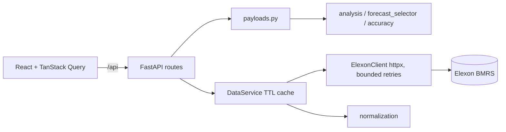

# WindWise — Wind Forecast Intelligence & Day-Ahead Procurement Decision Support

WindWise helps electricity procurement analysts see **which wind forecast was available when a purchasing decision had to be made**, and **how accurate it was** versus actual national wind generation (Elexon BMRS, January 2026 focus). It is a decision-support tool: it does not compute an optimal procurement position (no demand, contract or price inputs).

## Build / verification status (read first)
| Area | Status |
|---|---|
| Analytical core (timestamps, normalisation, forecast selection, metrics, payload builders) | 40 backend tests written and **executed and passing** in the authoring sandbox (pandas/numpy only, with a minimal stand-in for pytest). Re-run with real pytest. |
| Elexon client, FastAPI routes, API tests, client tests | Written; **not executed** (sandbox had no httpx/FastAPI). Run `pytest` locally. |
| Elexon endpoint/param details | Taken from the Elexon OpenAPI spec as reported by independent projects; **not verified live**. Run `python -m scripts.check_elexon 2026-01-10` from a networked machine. |
| React frontend | Written; **never installed, type-checked, linted, built or tested**. Expect to fix small compile/type errors on first `npm install && npm run build`. |
| Docker / compose / CI | Written; **not run**. |
| Deployment | **Not deployed.** No public URL exists. |
| Screenshots, video | Not produced. See `docs/demo-script.md`. |
| January 2026 results | **None yet** — the authoring sandbox had no internet. Generate them with `python -m scripts.generate_results` (see below); nothing in this repo is a real result until you do. |

## Data sources & field mapping
Base URL `https://data.elexon.co.uk/bmrs/api/v1` (no key). Licence: BMRS Data Licence Terms — attribute Elexon; check terms before redistributing data (tests use small synthetic fixtures).
- **FUELHH** `/datasets/FUELHH/stream?settlementDateFrom&settlementDateTo&fuelType=WIND` → `startTime`, `generation` (MW, average over the half-hour), `fuelType`, optional `publishTime`, `settlementDate`, `settlementPeriod`.
- **WINDFOR** `/datasets/WINDFOR/stream?publishDateTimeFrom&publishDateTimeTo` → `startTime` (delivery), `publishTime`, `generation` (MW). Reported to be hourly.

## Forecast selection & look-ahead bias
For each delivery interval: choose the forecast with the **latest `publishTime` ≤ decision cutoff**. Revisions published later are never used (they would leak future information). Publications are fetched by *publish* time starting `FORECAST_LOOKBACK_DAYS` (7) before the first cutoff, so December publications for early-January delivery are kept. The fetch window ends at the last cutoff; only the `/api/revisions` audit view fetches later data, to label revisions `LATER_UNAVAILABLE`.

**Decision cutoff.** The decision cutoff is configurable. The assignment specifies that day-ahead purchasing decisions are made before the delivery day but does not define an exact local cutoff time. The initial value of `09:20` (Europe/London, one day before delivery) is an **assumption** and must be validated against the intended market workflow. It represents the time the purchasing decision is made, not a forecast publication time. Selection uses forecasts with `publishTime ≤ cutoff`, computed in Europe/London with DST handled (a cutoff inside a spring-forward gap raises an error rather than being shifted). Settings: `DECISION_CUTOFF_LOCAL_TIME`, `DECISION_CUTOFF_DAYS_BEFORE`, `TIMEZONE` (only Europe/London supported).

## Evaluation resolution (hourly forecasts vs half-hourly actuals)
Forecast values are **never interpolated**. `EVALUATION_RESOLUTION=auto` inspects the WINDFOR `startTime` values: all on the hour → hourly evaluation; `:30` starts present → native half-hourly. In hourly mode the *actuals* are aggregated to the hour as the mean of the two half-hourly MW values (equal-length intervals, so this is the hourly mean MW); an hour with only one half-hour is treated as a missing actual, not averaged on partial data. Source records are kept unchanged. Matched-interval counts and coverage are reported at the evaluation resolution. Assumption still to confirm against Elexon documentation: `startTime` is the interval *start* in both datasets. Do not assume `:30` forecasts are missing until `scripts.check_elexon` / the results report shows the observed start minutes.

## Generating the real January 2026 results
```bash
cd backend
python -m scripts.check_elexon 2026-01-10                      # inspect fields, resolution, lead times
python -m scripts.generate_results --start 2026-01-01 --end 2026-01-31 --out-dir ../docs/results --save-raw
```
Writes `docs/results/results-2026-01-01_2026-01-31.{md,json}` containing MAE, RMSE, bias, MAPE, matched intervals and coverage, missing data, duplicates/invalid records, selected-forecast lead times, the observed source verification (fields, start minutes, ranges) and the run parameters. It exits with an error if Elexon returns no data. Quote only these generated numbers.


## Architecture

Folders: `backend/app/{api,clients,services,schemas,utils}`, `backend/tests`, `frontend/src/{app,components,features,hooks,services,types,utils,test}`, `docs/`.

## Run locally
Prerequisites: Python 3.12, Node 22, (optional) Docker.
```bash
# backend
cd backend && python -m venv .venv && source .venv/bin/activate
pip install -r requirements-dev.txt
pytest                         # tests + coverage
python -m scripts.check_elexon 2026-01-10   # verify live API assumptions
uvicorn app.main:app --reload  # http://localhost:8000/docs
# frontend (new terminal)
cd frontend && npm install && npm run dev    # http://localhost:5173 (proxies /api)
npm run lint && npm test && npm run build
```
Docker: `docker compose up --build` → UI http://localhost:8080, API docs http://localhost:8000/docs. Stop: `docker compose down`.
Config: copy `.env.example` to `.env`. No secrets are needed.

## API
`GET /api/health` · `/api/forecast?date=` · `/api/forecast-errors?date=` · `/api/accuracy?start=&end=` · `/api/overview?month=YYYY-MM` · `/api/data-quality?month=` · `/api/revisions?date=&interval_start=<ISO with zone>`. Schemas: `/docs`. Validation → 422; Elexon failure → 502 with a safe message; unexpected → generic 500. Range limit 62 days. Source data is cached in memory (TTL `CACHE_TTL_S`, default 900 s); metrics are recomputed per request. First month load can take a minute (many Elexon chunks).

## Known limitations
Cutoff is an assumption; hourly evaluation relies on the unverified assumption that startTime is the interval start; in-memory cache is lost on restart; no lead-time/revision-trend analysis (future work); one month ≠ long-term performance; no Playwright tests; no `package-lock.json` (run `npm install` once and commit it).

